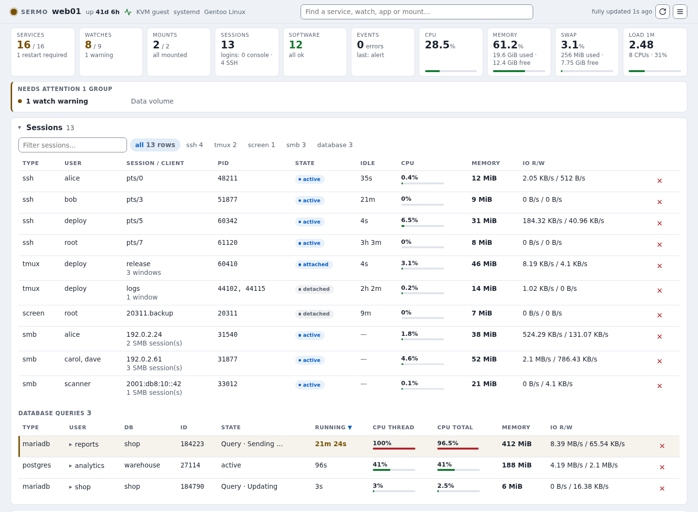
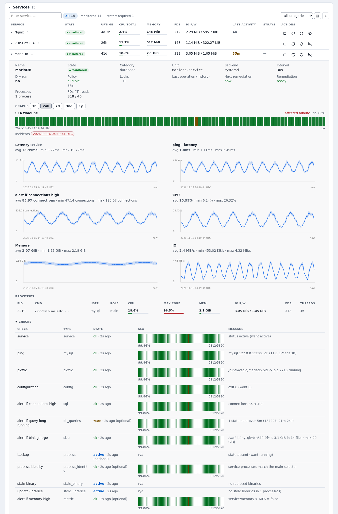
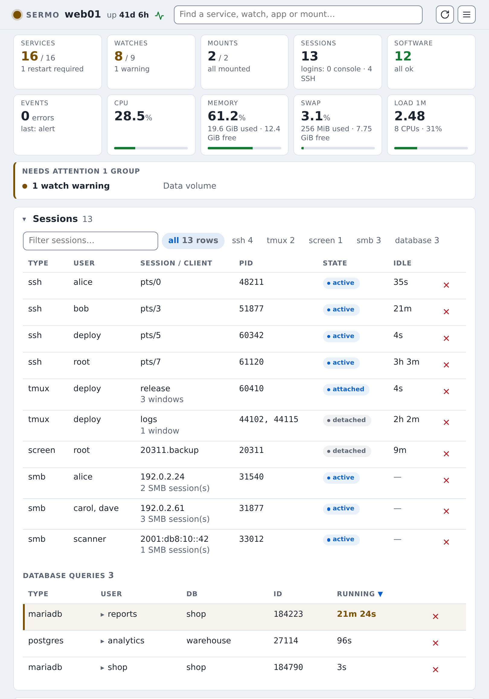
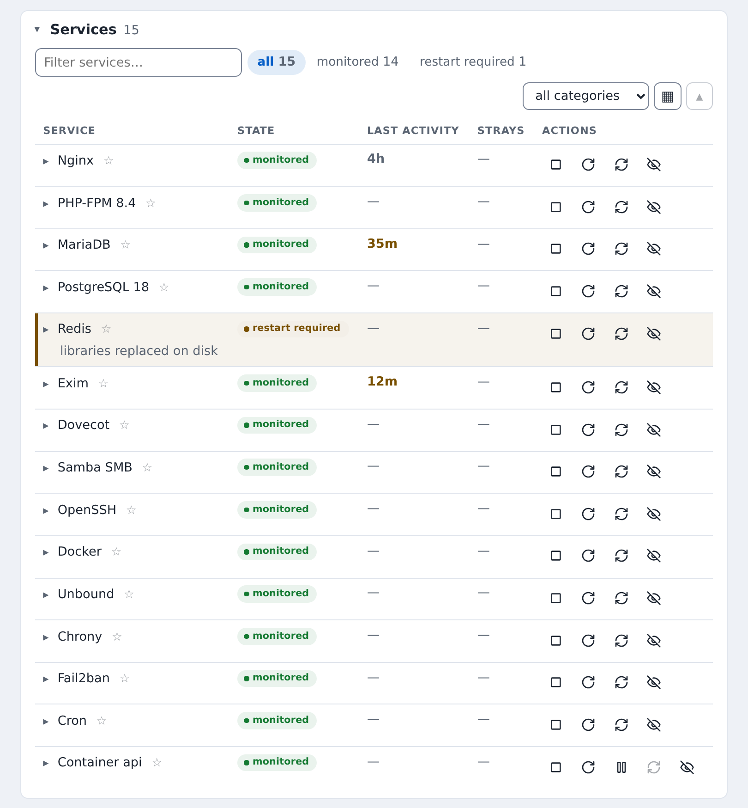
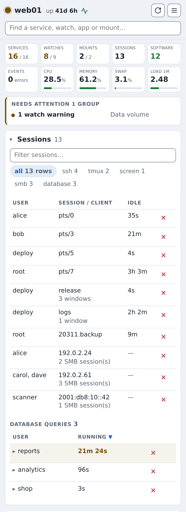
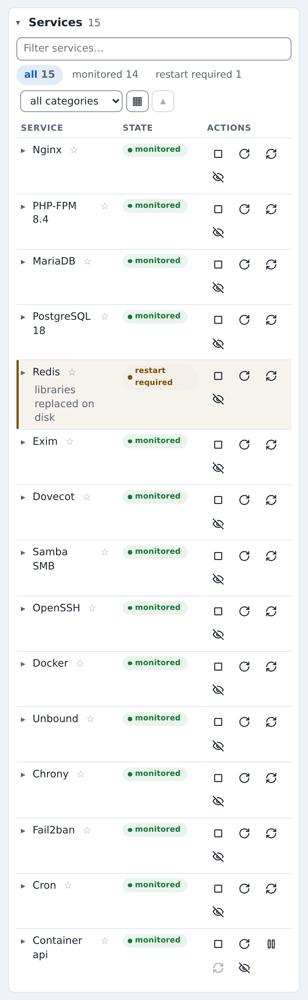

# Sermo

[English](README.md) · [Comparativa](#comparativa) · [Primeros pasos](#primeros-pasos) · [Documentación](#documentación)

**Sermo supervisa servicios Linux y comprueba si es seguro reiniciarlos.** Se ejecuta en el propio servidor junto a systemd u OpenRC. Un solo demonio prueba lo que usan los clientes, desde una petición HTTP hasta una conexión a la base de datos, y registra por qué ha intervenido o ha dejado el servicio en marcha.

Piensa en MariaDB durante una copia de seguridad. Si el perfil del catálogo detecta un proceso de copia como `mariadb-dump` ejecutándose con el usuario de backup configurado, bloquea tanto la parada como el reinicio. La misma protección se aplica si lo pide un administrador con `sermoctl` o si se dispara una regla de recuperación. Puedes consultar el motivo con `sermoctl events mariadb`. [Perfil de MariaDB](catalog/services/mariadb.yml)



## Por qué Sermo

- **Detecta un error de configuración antes de parar Nginx.** El perfil de Nginx ejecuta `nginx -t` antes de reiniciar. Tras el arranque, Sermo comprueba el endpoint HTTP configurado para que puedas ver si la aplicación vuelve a atender peticiones. [Perfil de Nginx](catalog/services/nginx.yml)
- **Distingue la saturación de una caída.** Si una sonda de base de datos compatible recibe «demasiadas conexiones», Sermo registra que el servidor está ocupado. Esa respuesta puede generar una alerta y nunca desencadena un reinicio. El panel de sesiones muestra las consultas en ejecución para investigar la carga. [Servidores ocupados](docs/safety.md#busy-servers) · [Panel web](docs/configuration.md#web-ui)
- **Localiza servicios que aún usan bibliotecas antiguas.** Tras actualizar un paquete, puedes inspeccionar el ejecutable y las bibliotecas que el proceso mantiene en memoria. Nginx puede reiniciarse cuando cambia la biblioteca OpenSSL configurada en su perfil. El perfil de MariaDB avisa de las bibliotecas reemplazadas para que puedas programar el reinicio. [Perfil de Nginx](catalog/services/nginx.yml) · [Perfil de MariaDB](catalog/services/mariadb.yml)
- **Reconstruye la incidencia en el cambio de guardia.** Contrasta las comprobaciones fallidas y el resultado de cada operación con la gráfica de latencia y el historial de disponibilidad. Los intervalos sin observaciones quedan visibles, de modo que una parada del monitor no aumenta el tiempo de caída. [Disponibilidad](docs/configuration.md#availability-sla)

## Comparativa

| Herramienta | Qué supervisa | Cómo recupera el servicio | Cuándo encaja |
|---|---|---|---|
| **Sermo** | Protocolos de aplicación, procesos de servicio, cargas Docker y libvirt, almacenamiento y red del host | Las comprobaciones del catálogo, los bloqueos de mantenimiento y las reglas de protección gobiernan las operaciones. Cada reinicio verifica la parada y el arranque y registra el resultado. | Recuperación en el propio host con panel local e historial de SLA, tanto en systemd como en OpenRC. [Modelo de seguridad](docs/safety.md) |
| **Monit** | Procesos locales, ficheros, sistemas de archivos y servicios de red | Una prueba puede avisar, ejecutar un programa o invocar los métodos configurados para el servicio. Los ciclos y las dependencias condicionan la intervención. | Sistemas Unix donde quieres definir las pruebas y los comandos de recuperación en un fichero de control. [Manual de Monit](https://mmonit.com/monit/documentation/monit.html) |
| **Unidades de servicio de systemd** | Estado de la unidad, terminación de procesos y señales periódicas de los servicios que usan el watchdog | `Restart=` selecciona las condiciones de salida que provocan un reinicio. La unidad puede ejecutar comprobaciones de arranque con `ExecStartPre=`. | Supervisión de procesos integrada en systemd. Sermo puede usar esa misma unidad para operar el servicio. [systemd.service](https://www.freedesktop.org/software/systemd/man/latest/systemd.service.html) |
| **Zabbix** | Métricas y eventos de múltiples servidores, aplicaciones y dispositivos de red | Los disparadores activan notificaciones y comandos remotos configurados. El mantenimiento programado permite pausar operaciones asociadas a problemas silenciados. | Paneles y alertas centralizados para toda la flota. [Descripción](https://www.zabbix.com/documentation/current/en/manual/introduction) · [Comandos remotos](https://www.zabbix.com/documentation/current/en/manual/config/notifications/action/operation/remote_command) · [Mantenimiento](https://www.zabbix.com/documentation/current/en/manual/events/maintenance) |

## Características

**Monitorización y salud**

- **Supervisión independiente por servicio.** Cada servicio ejecuta sus comprobaciones y evalúa sus reglas a su propio ritmo. Un fallo en su rutina de supervisión queda aislado del resto del demonio.
- Un amplio **catálogo de checks** ([lista completa](docs/rules.md#checks)):
  estado/versión/config del servicio, puertos TCP, endpoints HTTP(S) y
  WebSocket, expiración de certificados TLS, sondas nativas de protocolo
  (PostgreSQL, MySQL/MariaDB, Redis, MongoDB, SMTP/IMAP, DNS, LDAP, SNMP, AMQP,
  …), consultas SQL, replicación y sentencias de larga duración, integridad
  SQLite, salud del almacenamiento (SMART, RAID, LVM, rendimiento con
  `hdparm`), sensores de hardware, interfaz de salida, ruta por defecto, reglas
  de firewall, deriva de reloj, crecimiento de tamaño de ficheros/dirs y
  métricas de proceso/conteo.
- **Detección de código reemplazado** — servicios que siguen ejecutando un
  binario o una librería compartida que una actualización reemplazó en disco, y
  `restart_on_change` para reiniciar un servicio cuando cambia una de sus apps o
  de sus ficheros de configuración.
- **Interdependencias entre checks** (`requires` / `skip_when_changed`) para que
  un probe solo se ejecute cuando se cumplen sus prerrequisitos.
- **Host watches** — vigilan recursos que no son servicios (montajes, arrays
  RAID, uplinks de red, certificados, …), disparando comandos de hook y/o
  notificaciones, y reparando el almacenamiento cuando se pide (`then.expand`
  amplía un volumen, `then.remount` recupera un montaje colgado).
- **Watches de seguridad** — `process_policy` avisa cuando un usuario ejecuta un
  programa que su política no permite, y `unowned_processes` lista los procesos
  de los que no responde ninguna unidad de init ni paquete instalado. Aparecer
  en la lista no autoriza nada: solo el `kill_only_if` del propio watch o la
  elección verificada de un administrador le envían una señal.
- **Diagnóstico del host.** Correlaciona errores de logs, descriptores de fichero agotados, procesos zombis y unidades fallidas con el estado de los servicios. Hay comprobaciones específicas para la batería de un SAI con NUT y la salud de un clúster GlusterFS. [Catálogo de comprobaciones](docs/rules.md#checks)
- **Máquinas virtuales y contenedores.** Los asistentes descubren cargas de Docker y libvirt. Puedes comprobar su disponibilidad y pausarlas o reanudarlas desde la misma CLI. Sermo bloquea la destrucción de una red virtual con invitados conectados. [Servicios](docs/services.md) · [Seguridad](docs/safety.md)

**Remediación segura**

- Un único **engine de operación** compartido por la CLI y el daemon: lock de
  operación → locks de runtime con nombre → preflight requerido → guards →
  stop → verificar procesos y conciliar init → start →
  verificación + postflight.
- **Locks de runtime con nombre** para acotar ventanas de mantenimiento (backups,
  migraciones): `sermoctl lock … -- COMANDO` mantiene un lock con TTL durante la
  ejecución de un comando.
- **Guards, ventanas y política de remediación** para expresar *cuándo* y *con
  qué frecuencia* puede ejecutarse una acción, con escalado.
- **Invariantes de seguridad duros** que el YAML no puede desactivar (ver abajo).

**Disponibilidad e historial**

- **SLA en ventanas móviles** (hora → año) para cada servicio y watch de
  disponibilidad, guardado como un archivo por ventana de gráfica para que un año
  de historial siga acotado sin perder ningún incidente.
- Un **registro de eventos/actividad** con retención y compactación del almacén
  de estado.

**Herramientas de operación**

- Una **CLI** de operador enfocada (`sermoctl`) para status, acciones de ciclo de
  vida seguras, validación de config, locks, procesos, preflight, inventario, SLA
  y eventos.
- **Notificaciones** a email, Slack, Teams, Telegram, ntfy, Gotify y los
  terminales con sesión abierta (`tty`, `wall`) con una plantilla de mensaje por
  defecto, graduadas en cinco niveles
  de severidad (debug → critical): cada notifier fija el nivel mínimo que
  recibe, un umbral puede escalar de warning a error y a critical, y un
  incidente se anuncia una vez por nivel en lugar de una vez por watch.
- Un **bot de informes de Telegram** opcional e interactivo (solo lectura):
  pregúntale `/status`, `/services`, `/sla` y responde con informes en vivo —
  solo long polling, sin puerto de entrada, respondiendo a los chats de la lista
  permitida.
- Un **interruptor de pánico** a nivel de daemon para pausar toda la remediación
  automática al instante.
- Una **pausa de notificaciones** (`mute`) por servicio, vigilancia o
  notificador, de 1 minuto a 24 horas, para una ventana de mantenimiento o un
  canal que debe callar: la vigilancia y la remediación siguen funcionando, y
  la pausa termina sola.
- **Asistentes guiados** para configuraciones comunes (service, docker, vm,
  mount, volume, net, uplink).

**Dashboard web** (opcional)

- Un dashboard en vivo y autocontenido: checks por servicio, historial de SLA,
  gráficas de latencia, un feed de eventos, y el inventario completo (servicios /
  apps / librerías) y los host watches.
- Un panel de **Sesiones**: sesiones interactivas de SSH, tmux y screen,
  clientes SMB, y las sentencias en ejecución en MySQL, MariaDB y PostgreSQL,
  cada una con su CPU, memoria y E/S; un administrador puede cerrar una sesión
  verificada o cancelar una sentencia reverificada.
- **Una página para cualquier pantalla**: los mismos paneles en un ordenador,
  una tablet y un móvil, cada uno con las columnas que caben.
- **Dirigido por push** vía server-sent events con fallback a polling, y
  construido con accesibilidad **WCAG 2.2 AA**.
- HTTP en loopback por defecto, con accesos de administrador y de invitado de
  solo lectura desde ficheros de credenciales con hash — expónlo solo detrás de
  un reverse proxy TLS.

## Capturas

El dashboard es una única página autocontenida que sirve `sermod`. Todas las
imágenes muestran el mismo host ficticio.

**Un servicio en detalle.** Al desplegar una fila se ve lo que Sermo sabe de
él: la línea de tiempo del SLA con sus incidencias, las gráficas de latencia y
de recursos, los procesos reales con su núcleo más cargado, cada check con su
propia disponibilidad y su mensaje, y las reglas de guarda, alerta y
remediación con su progreso.



**Tablet y móvil.** Los mismos paneles de Sesiones y Servicios, reducidos a
las columnas que caben; las acciones de ciclo de vida siguen a un toque.

<p align="center">
  
  
</p>
<p align="center">
  
  
</p>

## Cómo funciona

Un único daemon (`sermod`) carga la configuración y el catálogo empaquetado, los
resuelve en un árbol de servicios, y construye una **flota**: un *Worker* por
servicio y un *Watch* por recurso de host o app. Un scheduler los ejecuta en
bucle. La CLI y la web UI hablan con el daemon vía HTTP y señales. Cada acción
sobre un servicio — manual o automática — pasa por `operation.Engine`, que
coordina locks, preflight, guards y el backend de init, de modo que la CLI y el
daemon nunca puedan divergir en cómo actúan.

```
clientes ── sermoctl (CLI) ─┐                    ┌── operation.Engine ── systemd / OpenRC
            navegador (Web) ─┤                    ├── locks con nombre (oplock + scanner)
                            │   sermod (daemon)   │
      señales ── SIGHUP ────┼── Monitor ─ Scheduler ─ Flota ┤── almacén de estado (SLA · eventos · métricas)
                 SIGTERM ───┘        │   (Worker por servicio│── notifiers (email/slack/teams/telegram/…)
                                     │    Watch por recurso) │
      config + catálogo empaquetado ─┘                       └── web.Server (dashboard + /api)
```

Ver [docs/architecture.md](docs/architecture.md) para los diagramas fieles
al código (pipeline de operación, estados de locks, ciclo de monitorización).

## Los dos binarios

- **`sermoctl`** — la CLI del operador: status, start/stop/restart/reload/
  resume/repair seguros (y pause para VMs de libvirt y contenedores Docker),
  validación de config, locks, procesos, preflight, disponibilidad/SLA,
  inventario y eventos. Los comandos de solo lectura no necesitan root.
- **`sermod`** — el daemon: un worker independiente por servicio ejecuta los
  checks, evalúa las reglas y dirige la remediación a través del mismo engine de
  operación segura que usa `sermoctl`. También ejecuta **host watches** que
  disparan comandos de hook y/o **notificaciones** (email, Slack, Teams,
  Telegram, ntfy, Gotify, terminales), y puede servir el **dashboard web**
  (configura `web.port`,
  recomendado `9797`) — HTTP en loopback con auth opcional; expónlo solo detrás
  de un reverse proxy TLS
  ([cómo](docs/configuration.md#behind-a-reverse-proxy-required-to-expose-it)).

## Invariantes de seguridad

No se pueden desactivar en YAML — la validación rechaza cualquier toggle
`security:` que lo intente. Completos en [docs/safety.md](docs/safety.md):

1. **Ninguna acción con un preflight requerido fallido** — bloqueada con
   `preflight_failed`.
2. **Ninguna acción que un guard bloquee** — los guards se evalúan antes de la
   remediación, y lo que hace una acción decide qué guards le aplican (un guard
   sobre `start` también bloquea `restart` y `repair`).
3. **Los locks de runtime con nombre activos siempre bloquean las acciones de
   servicio** — comprobado automáticamente, sin necesidad de regla.
4. **Nunca enviar señales a un residual sin verificar** — un residual solo
   recibe señales cuando lo nombra un selector `kill_only_if` explícito o una
   identidad estricta de `processes:`, o cuando el kernel lo sitúa en el grupo
   de control propio del servicio. SIGKILL además necesita `force_kill`: el
   valor por defecto del motor es `false`; el `sermo.yml` que se instala fija
   `auto`.
5. **El nombre de un proceso nunca autoriza una señal.** Sermo revalida la
   identidad al enviarla mediante un `pidfd`. Para un proceso residual del
   servicio exige el ejecutable y el usuario esperados, o la pertenencia al
   grupo de control del servicio demostrada por el kernel.
6. **Nunca enviar señales de terminación a PID 1 ni a hilos del kernel** —
   bloqueado centralmente, no configurable.
7. **`force_kill: true` requiere `kill_only_if`** con selectores `users` y
   `exe_any` no vacíos.
8. **Un restart siempre verifica el stop y el start** bajo los mismos locks,
   preflight, guards y plazo; si quedan procesos residuales sin resolver, se bloquea el nuevo arranque.
9. **Un proceso *stray* es un diagnóstico, nunca un objetivo** — un miembro del
   grupo de control que ningún selector reclama se reporta, y nada le envía
   señales por serlo.
10. **`process_policy` solo avisa, y `unowned_processes` no autoriza nada** —
    aparecer en la lista nunca convierte un proceso en objetivo de una señal.
11. **Nunca se destruye una red de libvirt con interfaces de invitados vivas.**
12. **Una sentencia de base de datos solo se cancela tras reverificarla** — una
    sentencia que cambió o terminó nunca se mata.
13. **Un servidor ocupado nunca se reinicia por estar ocupado** — "too many
    connections", "loading" o "starting up" significa que está vivo.

## Compilación

```sh
make build      # genera bin/sermoctl y bin/sermod
make test       # ejecuta las pruebas
```

Requiere Go 1.27.4+. Dependencias de runtime: `systemctl` o `rc-service` en el host.

**`sermod` se ejecuta como root.** Gestiona servicios que pertenecen a distintos usuarios y
accede a áreas privilegiadas (control de servicios, envío de señales a procesos de otros usuarios,
inspección de `/proc` entre usuarios incluyendo IO por proceso, sockets ICMP raw), por lo que las
unidades empaquetadas lo ejecutan como root; avisa al arrancar si no lo es. Por tanto la config es
entrada confiable, propiedad de root — los checks `command` y los `hook`s se ejecutan como root
(nunca a través de un shell), así que mantén `/etc/sermo` solo para root y pon los secretos en el
entorno (`${env:NAME}`). Ver [safety](docs/safety.md#privileges-the-daemon-runs-as-root).
Los comandos de `sermoctl` de solo lectura (status, config, etc.) no necesitan root.

## Instalación

`make install` respeta las variables estándar de directorios GNU y el staging de
`DESTDIR`, e instala los binarios, el catálogo completo (manteniendo el
layout `services/apps/libs/patterns`), los ejemplos, un `sermo.yml` de ejemplo, la plantilla de
notificación por defecto, la config de tmpfiles.d, y tanto la unidad de systemd como el
script de init de OpenRC (con sus rutas de binario/config reescritas para coincidir).
El script de OpenRC escribe su log en `/var/log/sermod.log`, e `install-openrc`
añade la regla de logrotate que lo rota en el sitio (`copytruncate`):

```sh
sudo make install PREFIX=/usr                 # /usr/bin, /usr/sbin or merged-/usr /usr/bin, /etc/sermo, ...
make install DESTDIR=/tmp/stage PREFIX=/usr    # preparar el árbol para empaquetarlo
```

Variables clave (anula en la línea de comandos): `DESTDIR`, `PREFIX`/`prefix`,
`bindir`, `sbindir`, `datadir`, `sysconfdir`, `TMPFILESDIR`,
`SYSTEMD_UNITDIR`, `OPENRC_INITDIR`, `LOGROTATEDIR`. También hay targets granulares disponibles:
`install-bin`, `install-catalog`, `install-examples`, `install-config`,
`install-templates`, `install-tmpfiles`, `install-systemd`, `install-openrc`
(y `uninstall`). Un
`sermo.yml` existente nunca se sobrescribe. `make install` no crea
`/var/lib/sermo`; la config de tmpfiles.d instalada se encarga de crear ese directorio.

En hosts con merged-/usr donde `/usr/sbin` es un symlink a `/usr/bin`, el
`sbindir` por defecto colapsa a `$(bindir)` para que los paquetes con `DESTDIR` no materialicen un
directorio `usr/sbin` real y reemplacen el symlink del host al extraerse. Pasa un
`sbindir=...` explícito solo cuando el destino tenga realmente un directorio sbin distinto.

No despliegues un árbol `DESTDIR` extrayendo un archivo tar directamente en `/`
con los metadatos de directorio preservados. Un árbol staged contiene entradas de directorio como
`./`, `etc/` y `usr/`; un `tar -xpf` simple puede aplicar esos modos a directorios
de sistema existentes. Usa el gestor de paquetes, copia los archivos instalados directamente,
o extrae archivos de prueba ad-hoc con:

```sh
sudo tar --no-overwrite-dir -C / -xpf sermo-stage.tar
```

## Primeros pasos

Con los binarios instalados, identifica el sistema de init, consulta una unidad
existente y descubre qué perfiles del catálogo reconoce Sermo en este host.

```sh
sermoctl backend
sermoctl status nginx
sermoctl services catalog
```

Para incorporar un servicio, ejecuta el asistente con permisos de administrador.
Revisa el destino detectado y la configuración antes de confirmar. Selecciona
`dry_run` para observar qué harían las reglas automáticas. Las operaciones
manuales de `sermoctl` actúan sobre el servicio incluso en ese modo.

```sh
sermoctl wizard service
sermoctl config validate
```

Para ejecutar el demonio en primer plano con la configuración instalada, usa
`sermod run --config /etc/sermo/sermo.yml`.

Con el demonio en marcha y el servicio configurado, estas consultas sirven
para investigar una incidencia. Sustituye `nginx` por el nombre configurado.

```sh
sermoctl processes nginx   # procesos atribuidos al servicio
sermoctl locks nginx       # bloqueos de mantenimiento activos
sermoctl events nginx      # qué ocurrió y con qué resultado
sermoctl sla nginx         # disponibilidad observada
```

Para proteger una tarea de mantenimiento, envuelve el comando real con un
bloqueo con caducidad. Por ejemplo, si el servicio se llama `mariadb` y la
copia dura menos de una hora, el siguiente comando ejecuta el script de copia
y mantiene el bloqueo mientras se ejecuta.

```sh
sermoctl lock mariadb --reason backup --ttl 1h -- /usr/local/bin/backup.sh
```

Las definiciones empaquetadas viven en [`catalog/`](catalog/), las configs de ejemplo en
[`examples/`](examples/), las unidades de empaquetado en [`packaging/`](packaging/). El
layout de archivos en el host está en
[configuration → layout](docs/configuration.md#layout).
Los flags del daemon (`--verbose`) están en
[CLI → sermod daemon flags](docs/cli.md#sermod-daemon-flags).

## Documentación

- [Configuration](docs/configuration.md) — config global, catalog services, servicios,
  merge y variables; [`docs/sermo-all.yml`](docs/sermo-all.yml) es el
  ejemplo anotado completo.
- [Rules](docs/rules.md) — checks, condiciones, ventanas, guards, política de
  remediación.
- [Services](docs/services.md) — escritura y override de servicios.
- [CLI](docs/cli.md) — comandos, flags y códigos de salida.
- [Seguridad](docs/safety.md) — requisitos para operar un servicio, verificar procesos y enviar señales.
- [Web dashboard](docs/configuration.md#web-ui) — qué significa cada panel,
  badge y gráfica del dashboard.
- [Architecture](docs/architecture.md) — diagramas de extremo a extremo del
  daemon, el pipeline de operación, los estados de locks y el ciclo de
  monitorización.
