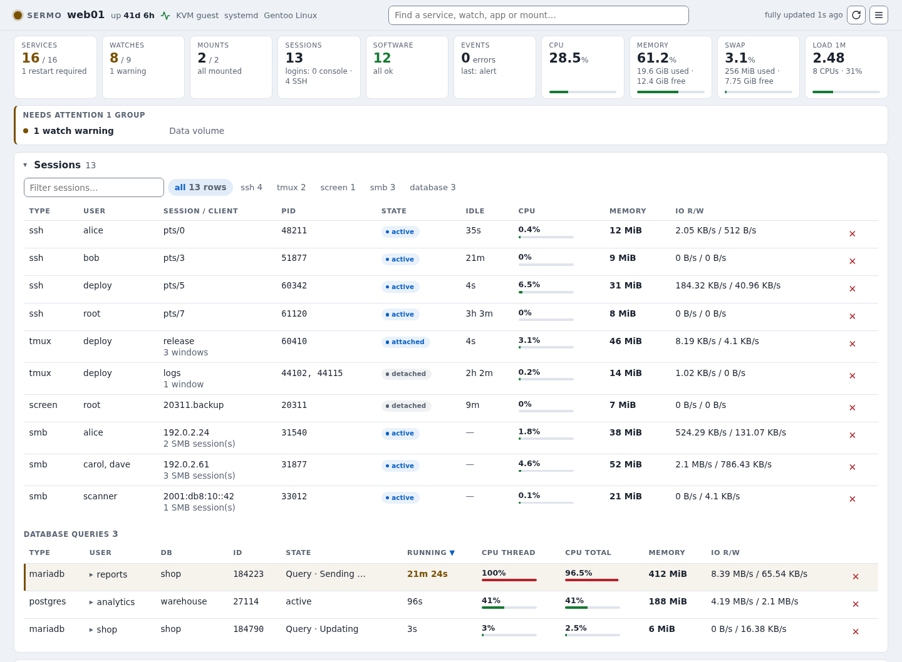
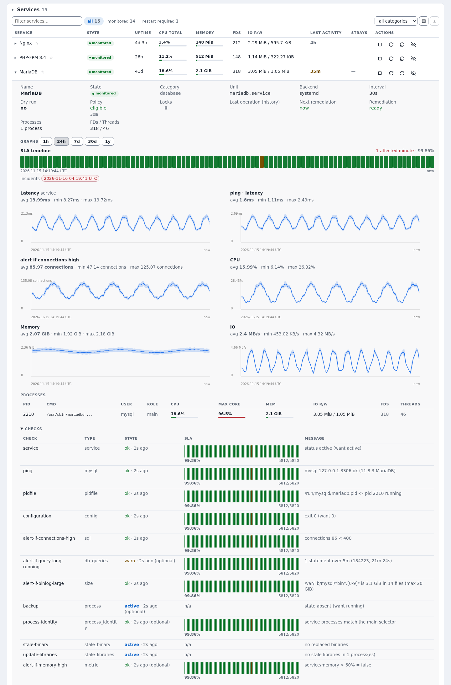
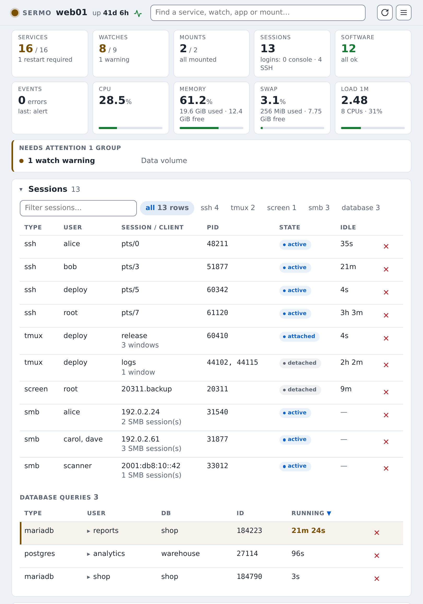
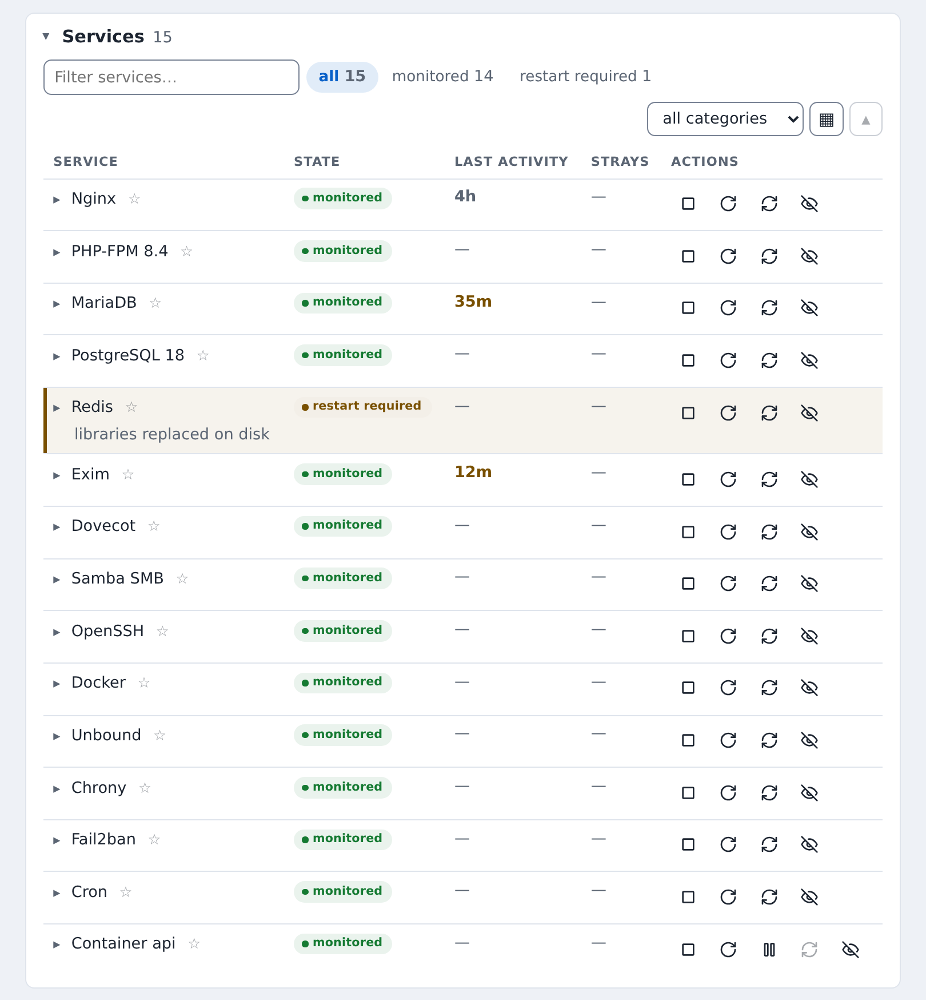
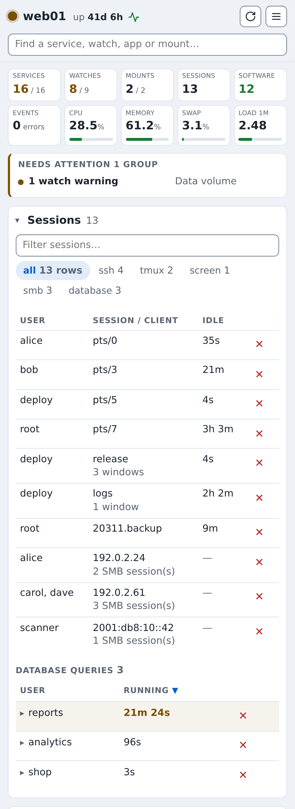
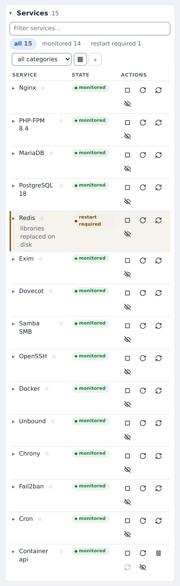

# Sermo

[Español](README.es.md) · [Comparison](#comparison) · [Quick start](#quick-start) · [Documentation](#documentation)

**Sermo monitors Linux services and verifies whether a restart is safe.** It runs on the host alongside systemd or OpenRC. One daemon checks what clients actually use, from an HTTP endpoint to a database connection, and records why it acted or why it left the service running.

Take MariaDB during a backup. If the packaged profile detects a backup process such as `mariadb-dump` running as the configured backup user, it blocks both stop and restart. The same guard applies when an operator uses `sermoctl` and when a recovery rule fires. Inspect the decision with `sermoctl events mariadb`. [MariaDB profile](catalog/services/mariadb.yml)



## Why Sermo

- **Catch a configuration error before stopping Nginx.** The Nginx profile runs `nginx -t` before a restart. Once Nginx starts, Sermo checks the configured HTTP endpoint so an operator can see whether the application serves requests again. [Nginx profile](catalog/services/nginx.yml)
- **Tell overload from an outage.** When a supported database probe gets a “too many connections” reply, Sermo records a busy result. That result can raise an alert and cannot trigger a restart. The Sessions panel shows running statements for investigating the load. [Busy servers](docs/safety.md#busy-servers) · [Dashboard](docs/configuration.md#web-ui)
- **Find processes still using yesterday’s libraries.** After a package update, inspect the executable and shared libraries still mapped by a service. Nginx can restart after a tracked OpenSSL change. MariaDB’s profile raises an advisory for a replaced library so you can schedule the restart. [Nginx profile](catalog/services/nginx.yml) · [MariaDB profile](catalog/services/mariadb.yml)
- **Reconstruct the incident at handover.** Compare check failures and operation outcomes with the service’s latency graph and availability history. Gaps in observation stay visible, so a stopped monitor does not inflate downtime. [Availability](docs/configuration.md#availability-sla)

## Comparison

| Tool | What it monitors | How recovery works | Where it fits |
|---|---|---|---|
| **Sermo** | Application protocols, service processes, Docker and libvirt workloads, host storage and networking | Catalog checks, maintenance locks and guards govern each service action. A restart verifies shutdown and startup and records its outcome. | On-host recovery with a local dashboard and SLA history across systemd and OpenRC. [Safety model](docs/safety.md) |
| **Monit** | Local processes, files, filesystems and network services | Tests can alert, execute a program or call configured service methods. Cycle counts and dependencies control when to act. | Unix hosts where you want to define the tests and recovery commands in a control file. [Monit manual](https://mmonit.com/monit/documentation/monit.html) |
| **systemd service units** | Unit state, process exits and watchdog heartbeats from participating services | `Restart=` selects the exit conditions that trigger recovery. Units can run startup checks with `ExecStartPre=`. | Native process supervision on systemd. Sermo can use that same unit for lifecycle operations. [systemd.service](https://www.freedesktop.org/software/systemd/man/latest/systemd.service.html) |
| **Zabbix** | Metrics and events across hosts, applications and network devices | Triggers drive notifications and configured remote commands. Scheduled maintenance can pause operations for suppressed problems. | Central dashboards and alerting across a fleet. [Overview](https://www.zabbix.com/documentation/current/en/manual/introduction) · [Remote commands](https://www.zabbix.com/documentation/current/en/manual/config/notifications/action/operation/remote_command) · [Maintenance](https://www.zabbix.com/documentation/current/en/manual/events/maintenance) |

## Features

**Monitoring & health**

- A **fleet of independent workers** — one per service — each running its own
  checks, evaluating rules and driving remediation on its own schedule; a panic
  in one worker never takes down the daemon.
- A broad **check catalog** ([full list](docs/rules.md#checks)): service
  state/version/config, TCP ports, HTTP(S) and WebSocket endpoints, TLS
  certificate expiry, native protocol probes (PostgreSQL, MySQL/MariaDB, Redis,
  MongoDB, SMTP/IMAP, DNS, LDAP, SNMP, AMQP, …), SQL queries, replication and
  long-running statements, SQLite integrity, storage health (SMART, RAID, LVM,
  `hdparm` throughput), hardware sensors, egress interface, default route,
  firewall rules, clock drift, file/dir size growth, and process/count metrics.
- **Replaced code detection** — services still running a binary or shared
  library replaced on disk by an update, and `restart_on_change` to restart a
  service when one of its apps or configuration files changes.
- **Check interdependencies** (`requires` / `skip_when_changed` /
  `skip_when_idle`) so a probe is only run when its prerequisites hold and, with
  `skip_when_idle`, does not wake a socket-activated daemon waiting for its socket.
- **Host watches** — monitor resources that aren't services (mounts, RAID
  arrays, network uplinks, certificates, …), firing hook commands and/or
  notifications, and repairing storage when asked (`then.expand` grows a
  volume, `then.remount` recovers a hung mount).
- **Security watches** — `process_policy` alerts when a user runs a program its
  policy does not allow, and `unowned_processes` lists processes no init unit or
  installed package accounts for. Being listed authorizes nothing: only the
  watch's own `kill_only_if` or an administrator's verified choice signals one.
- **Host diagnostics.** Correlate log errors, file descriptor exhaustion, zombie processes and failed units with service health. Dedicated checks cover UPS battery status through NUT and GlusterFS cluster health. [Check catalog](docs/rules.md#checks)
- **Virtual machines and containers.** Discover Docker and libvirt workloads with the wizards, check availability, and pause or resume them from the same CLI. Sermo blocks destruction of a virtual network with attached guests. [Services](docs/services.md) · [Safety](docs/safety.md)

**Safe remediation**

- A single **operation engine** shared by the CLI and the daemon: operation
  lock → named runtime locks → required preflight → guards →
  stop → verify processes and reconcile init → start → verify +
  postflight.
- **Named runtime locks** to fence maintenance windows (backups, migrations):
  `sermoctl lock … -- COMMAND` holds a TTL'd lock for the duration of a command.
- **Guards, windows and remediation policy** to express *when* and *how often* an
  action may run, with escalation.
- **Hard safety invariants** that YAML cannot disable (see below).

**Availability & history**

- **SLA over rolling windows** (hour → year) for every service and availability
  watch, stored as one archive per graph window so a year of history stays
  bounded without losing an incident.
- An **event/activity log** with retention and compaction of the state store.

**Operate**

- A focused operator **CLI** (`sermoctl`) for status, safe lifecycle actions,
  config validation, locks, processes, preflight, inventory, SLA and events.
- **Notifications** to email, Slack, Teams, Telegram, ntfy, Gotify and the
  logged-in terminals (`tty`, `wall`) with a templated default message, graded
  on five severity levels
  (debug → critical): each notifier sets the lowest level it receives, a
  threshold can escalate from warning to error to critical, and an incident is
  announced once per level instead of once per watch.
- An optional **interactive Telegram report bot** (read-only): ask it `/status`,
  `/services`, `/sla` and it replies with live reports — long polling only, no
  inbound port, answering allow-listed chats.
- A **daemon-wide panic switch** to pause all automatic remediation instantly.
- A **notification mute** per service, watch or notifier, from 1 minute to 24
  hours, for a maintenance window or a channel that must stay quiet:
  monitoring and remediation keep running, and the mute ends on its own.
- **Guided wizards** for common setups (service, docker, vm, mount, volume, net,
  uplink).

**Web dashboard** (optional)

- A live, self-contained dashboard: per-service checks, SLA history, latency
  graphs, an event feed, and the full inventory (services / apps / libraries)
  and host watches.
- A **Sessions** panel: interactive SSH, tmux and screen sessions, SMB
  clients, and the statements running on MySQL, MariaDB and PostgreSQL, each
  with its CPU, memory and I/O; an administrator can close a verified session
  or cancel a re-verified statement.
- **One page for every screen**: the same panels on a desktop, a tablet and a
  phone, each showing the columns that fit.
- **Push-driven** via server-sent events with a polling fallback, and built to
  **WCAG 2.2 AA** accessibility.
- Loopback HTTP by default, with admin and read-only guest logins from hashed
  credential files — expose it only behind a TLS reverse proxy.

## Screenshots

The dashboard is one self-contained page served by `sermod`. Every image shows
the same fictional host.

**A service in detail.** Expanding a row shows what Sermo knows about it: the
SLA timeline with its incidents, latency and resource graphs, the real
processes with their busiest core, every check with its own availability and
message, and the guard, alert and remediation rules with their progress.



**Tablet and phone.** The same Sessions and Services panels, narrowed to the
columns that fit; the lifecycle actions stay one tap away.

<p align="center">
  
  
</p>
<p align="center">
  
  
</p>

## How it works

A single daemon (`sermod`) loads the configuration and the packaged catalog,
resolves them into a service tree, and builds a **fleet**: one *Worker* per
service and one *Watch* per host resource or app. A scheduler runs them in a
loop. The CLI and the web UI talk to the daemon over HTTP and signals. Every
action on a service — manual or automatic — goes through `operation.Engine`,
which coordinates locks, preflight, guards and the init backend, so the CLI and
the daemon can never diverge in how they act.

```
clients ── sermoctl (CLI) ─┐                    ┌── operation.Engine ── systemd / OpenRC
           browser (Web UI) ┤                    ├── named locks (oplock + scanner)
                            │   sermod (daemon)  │
      signals ── SIGHUP ────┼── Monitor ─ Scheduler ─ Fleet ┤── state store (SLA · events · metrics)
                SIGTERM ────┘        │   (Worker per service │── notifiers (email/slack/teams/telegram/…)
                                     │    Watch per resource)│
      config + packaged catalog ────┘                       └── web.Server (dashboard + /api)
```

See [docs/architecture.md](docs/architecture.md) for the faithful,
code-anchored diagrams (operation pipeline, lock states, monitoring cycle).

## The two binaries

- **`sermoctl`** — the operator CLI: status, safe start/stop/restart/reload/
  resume/repair (and pause for libvirt VMs and Docker containers), config
  validate, locks, processes, preflight, availability/SLA, inventory and events.
  Read-only commands do not need root.
- **`sermod`** — the daemon: one independent worker per service runs checks,
  evaluates rules and drives remediation through the same safe operation engine
  `sermoctl` uses. It also runs **host watches** that fire hook commands and/or
  **notifications** (email, Slack, Teams, Telegram, ntfy, Gotify, terminals),
  and can serve the **web
  dashboard** (set `web.port`, recommended `9797`) — loopback HTTP with optional
  auth; expose it only behind a TLS reverse proxy
  ([how](docs/configuration.md#behind-a-reverse-proxy-required-to-expose-it)).

## Safety invariants

These cannot be turned off in YAML — validation rejects any `security:` toggle
that tries. In full in [docs/safety.md](docs/safety.md):

1. **No action on a failed required preflight** — blocked with `preflight_failed`.
2. **No action a guard blocks** — guards are evaluated before remediation, and
   what an action performs decides which guards apply (a guard on `start` also
   blocks `restart` and `repair`).
3. **Active named runtime locks always block service actions** — checked
   automatically, no rule needed.
4. **Never signal an unverified residual** — a residual is signalled only when
   an explicit `kill_only_if` selector or a strict `processes:` identity names
   it, or the kernel places it in the service's own control group. SIGKILL also
   needs `force_kill`: the engine default is `false`; the shipped `sermo.yml`
   sets `auto`.
5. **A process name never authorizes a signal.** Sermo revalidates identity
   through a `pidfd` at delivery. For a service residual it requires the
   expected executable and user or kernel proof of service cgroup membership.
6. **Never send terminating signals to PID 1 or kernel threads** — blocked
   centrally, not configurable.
7. **`force_kill: true` requires `kill_only_if`** with non-empty `users` and
   `exe_any` selectors.
8. **Restart always verifies stop and start** under the same locks, preflight,
   guards and deadline; unresolved residuals block the new start.
9. **A stray process is a diagnostic, never a target** — a control-group member
   no selector claims is reported, and nothing signals it for being a stray.
10. **`process_policy` only alerts, and `unowned_processes` authorizes
    nothing** — being listed never makes a process a signal target.
11. **A libvirt network with live guest interfaces is never destroyed.**
12. **A database statement is cancelled only after it is re-verified** — a
    changed or finished statement is never killed.
13. **A busy server is never restarted for being busy** — "too many
    connections", "loading" or "starting up" means it is alive.

## Build

```sh
make build      # produces bin/sermoctl and bin/sermod
make test       # run the test suite
```

Requires Go 1.27.4+. Runtime dependencies: `systemctl` or `rc-service` on the host.

**`sermod` runs as root.** It manages services owned by different users and
accesses privileged areas (service control, signalling other users' processes,
cross-user `/proc` inspection including per-process IO, raw ICMP sockets), so the
packaged units run it as root; it warns at startup if it is not. The config is
therefore trusted, root-owned input — `command` checks and `hook`s run as root
(never via a shell), so keep `/etc/sermo` root-only and put secrets in the
environment (`${env:NAME}`). See [safety](docs/safety.md#privileges-the-daemon-runs-as-root).
Read-only `sermoctl` commands (status, config, etc.) do not need root.

## Install

`make install` honors the standard GNU directory variables and `DESTDIR`
staging, and installs the binaries, the full catalog (keeping the
`services/apps/libs/patterns` layout), the examples, a sample `sermo.yml`, the
default notification template, the tmpfiles.d config, and both the systemd unit and the
OpenRC init script (with their binary/config paths rewritten to match). The
OpenRC script logs to `/var/log/sermod.log`, and `install-openrc` adds the
logrotate rule that rotates it in place (`copytruncate`):

```sh
sudo make install PREFIX=/usr                 # /usr/bin, /usr/sbin or merged-/usr /usr/bin, /etc/sermo, ...
make install DESTDIR=/tmp/stage PREFIX=/usr    # stage for packaging
```

Key variables (override on the command line): `DESTDIR`, `PREFIX`/`prefix`,
`bindir`, `sbindir`, `datadir`, `sysconfdir`, `TMPFILESDIR`,
`SYSTEMD_UNITDIR`, `OPENRC_INITDIR`, `LOGROTATEDIR`. Granular targets are available too:
`install-bin`, `install-catalog`, `install-examples`, `install-config`,
`install-templates`, `install-tmpfiles`, `install-systemd`, `install-openrc`
(and `uninstall`). An
existing `sermo.yml` is never overwritten. `make install` does not create
`/var/lib/sermo`; the installed tmpfiles.d config owns that directory creation.

On merged-/usr hosts where `/usr/sbin` is a symlink to `/usr/bin`, the default
`sbindir` collapses to `$(bindir)` so `DESTDIR` packages do not materialize a
real `usr/sbin` directory and replace the host symlink when extracted. Pass an
explicit `sbindir=...` only when the target really has a distinct sbin directory.

Do not deploy a `DESTDIR` tree by extracting a tar archive directly into `/`
with preserved directory metadata. A staged tree contains directory entries such
as `./`, `etc/` and `usr/`; plain `tar -xpf` can apply those modes to existing
system directories. Use the package manager, copy the installed files directly,
or extract ad-hoc test archives with:

```sh
sudo tar --no-overwrite-dir -C / -xpf sermo-stage.tar
```

## Quick start

With the binaries installed, identify the init system, inspect an existing unit
and discover which catalog profiles Sermo recognizes on this host.

```sh
sermoctl backend
sermoctl status nginx
sermoctl services catalog
```

To bring a service under monitoring, run the wizard with administrator
permissions. Review the detected target and configuration before confirming.
Select `dry_run` to observe what automatic remediation would do. Manual
`sermoctl` operations act on the service even in this mode.

```sh
sermoctl wizard service
sermoctl config validate
```

To run the daemon in the foreground with the installed configuration, use
`sermod run --config /etc/sermo/sermo.yml`.

Once the daemon is running and the service is configured, use these queries
to investigate an incident. Substitute your configured service name for `nginx`.

```sh
sermoctl processes nginx   # processes attributed to the service
sermoctl locks nginx       # active maintenance locks
sermoctl events nginx      # what happened and how it ended
sermoctl sla nginx         # observed availability
```

To protect a maintenance job, wrap the actual command in a lock with an
expiry. For example, if the service is named `mariadb` and the backup takes
less than an hour, the following command runs the backup script and holds the
lock while it runs.

```sh
sermoctl lock mariadb --reason backup --ttl 1h -- /usr/local/bin/backup.sh
```

Packaged definitions live under [`catalog/`](catalog/), sample configs under
[`examples/`](examples/), packaging units under [`packaging/`](packaging/). The
on-host file layout is in
[configuration → layout](docs/configuration.md#layout).
Daemon flags (`--verbose`) are in
[CLI → sermod daemon flags](docs/cli.md#sermod-daemon-flags).

## Documentation

- [Configuration](docs/configuration.md) — global config, catalog services, services,
  merge and variables; [`docs/sermo-all.yml`](docs/sermo-all.yml) is the
  complete annotated example.
- [Rules](docs/rules.md) — checks, conditions, windows, guards, remediation
  policy.
- [Services](docs/services.md) — writing and overriding services.
- [CLI](docs/cli.md) — commands, flags and exit codes.
- [Safety](docs/safety.md) — requirements for service operations, process identity and signalling.
- [Web dashboard](docs/configuration.md#web-ui) — enabling the dashboard, its
  access model and what it shows.
- [Architecture](docs/architecture.md) — end-to-end diagrams of the daemon,
  the operation pipeline, lock states and the monitoring cycle.
